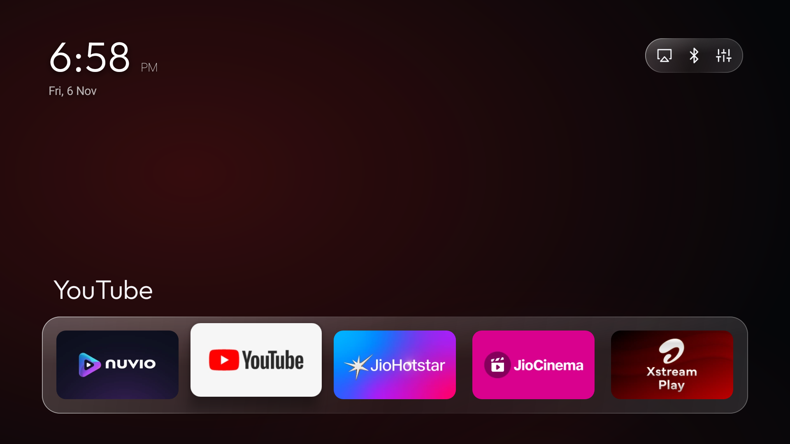
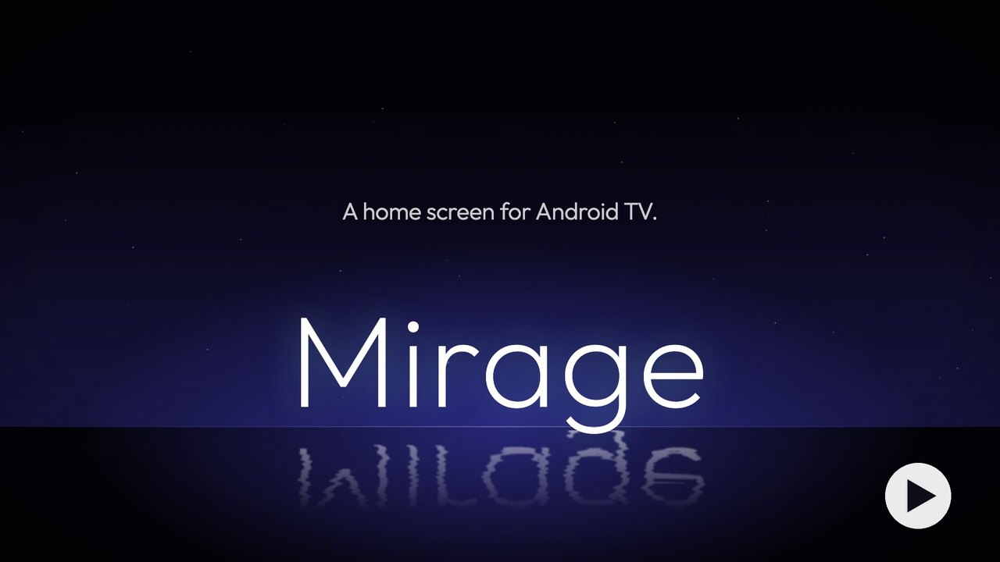
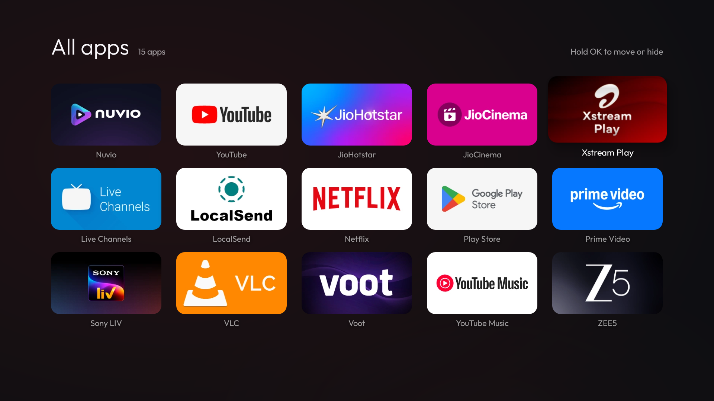
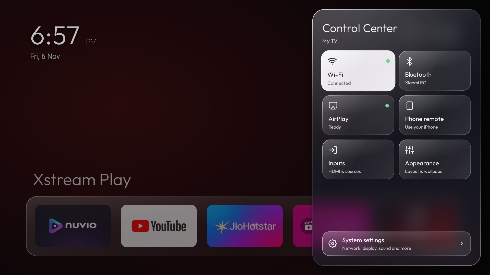
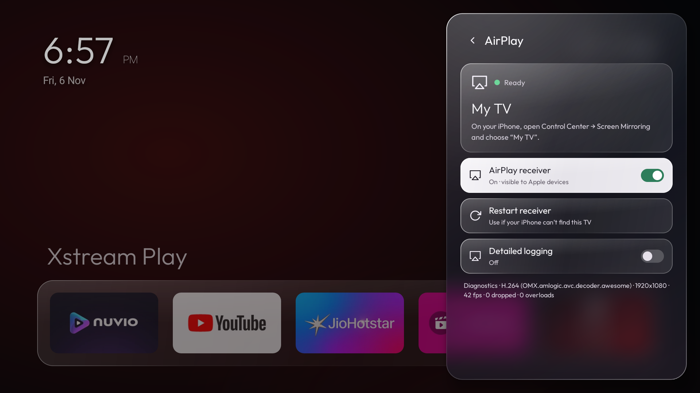

# Mirage

<p align="center">
  
</p>

**A fast, quiet home screen for Android TV with AirPlay built in.**

[](https://github.com/HiteshRohira/Mirage/releases/download/v1.1.16/Mirage-launch-film.mp4)

Mirage replaces the stock Google TV home with a calm, glass-styled launcher: a clock, an ambient background that takes its colour from the app you're on, and one row of favourite apps. Everything else stays out of the way until you ask for it. It has no ads, recommendations, accounts or telemetry.

<details>
<summary>More screenshots</summary>

### All apps



### Control Center



### AirPlay



</details>

## Features

- **Home and All apps.** One favourites row on Home, with large 16:9 app banners. Press Down for a full-screen grid of every app. Hold OK on an app to move, hide or inspect it.
- **Control Center.** A glass side sheet with live tiles for Wi‑Fi, Bluetooth, AirPlay, Phone remote, Inputs and Appearance, plus a shortcut to Android settings.
- **Bluetooth.** Paired devices sit one click from Home, and you can connect or disconnect audio devices in the same sheet. On Android 12 and newer you can pair new devices there too.
- **Built-in AirPlay.** iPhone, iPad and Mac can mirror the screen and stream music to the TV, and apps such as Photos and YouTube can hand video off to it. There's no separate app to install or keep alive. Video handoff depends on the sender: Safari support is still being tested, and QuickTime local-file casting isn't supported.
- **Phone remote.** The TV serves its own remote web app on your home network, with a direction pad, playback, volume and keyboard text entry. Nothing is hosted in the cloud. See [setup](glasslauncher/PHONE-REMOTE.md).
- **Gentle on old hardware.** Designed and tuned on a TCL Google TV (Android 11, 32-bit ARM, ~1.4 GB RAM), with [measured results](docs/PERFORMANCE-RESULTS.md). Also runs on a Xiaomi Mi Box 4 (Android 9, 32-bit ARM).

## Download

Get the signed **[1.1.16 release](https://github.com/HiteshRohira/Mirage/releases/tag/v1.1.16)**, or see [what's new](CHANGELOG.md).

| Android ABI | Standalone APK | Size |
|---|---|---:|
| 32-bit ARM (`armeabi-v7a`) | [Download](https://github.com/HiteshRohira/Mirage/releases/download/v1.1.16/Mirage-1.1.16-armeabi-v7a-compact.apk) | 3.82 MB |
| 64-bit ARM (`arm64-v8a`) | [Download](https://github.com/HiteshRohira/Mirage/releases/download/v1.1.16/Mirage-1.1.16-arm64-v8a-compact.apk) | 5.37 MB |

Requires Android 8 or newer. Each APK is the complete app, so install only the one that matches your TV. Some 64-bit processors run 32-bit Android, so check rather than guess.

## Install

With ADB connected to your TV, check which APK it needs, then install it:

```sh
adb shell getprop ro.product.cpu.abilist
adb install -r Mirage-1.1.16-armeabi-v7a-compact.apk
```

If `arm64-v8a` is listed, use the 64-bit APK. Otherwise use the 32-bit one.

Open Mirage from the TV's app list and follow its setup, or choose it in Android's default Home settings. Your previous launcher stays installed, so you can switch back. To update, install the new APK over the old one: your settings and pairings are kept.

## Build from source

```sh
git clone --recursive https://github.com/HiteshRohira/Mirage.git
cd Mirage/glasslauncher
gradle --no-daemon :app:assembleRelease
```

You'll need JDK 17, Android SDK 36, NDK `27.0.12077973`, CMake `3.31.6` and Gradle `8.14.5`. See [Building Mirage](docs/BUILDING.md) for signing, build options and the project layout.

## Licensing

- Launcher code is under the **PolyForm Noncommercial License 1.0.0** ([LICENSE](./LICENSE), [NOTICE.md](./NOTICE.md)). Personal and other non-commercial use, modification and sharing are allowed; commercial use is not.
- The AirPlay module (`glasslauncher/airplay`) is adapted from [jqssun/android-airplay-server](https://github.com/jqssun/android-airplay-server) and builds on [UxPlay](https://github.com/FDH2/UxPlay). It is under the **GPL-3.0** ([glasslauncher/airplay/LICENSE](glasslauncher/airplay/LICENSE)).
- Third-party components keep their own licenses.

Mirage is built on [Glass Launcher](https://github.com/namillis/GlassLauncherTV). It isn't affiliated with or endorsed by Apple, Google, TCL or Xiaomi. AirPlay is a trademark of Apple Inc.
